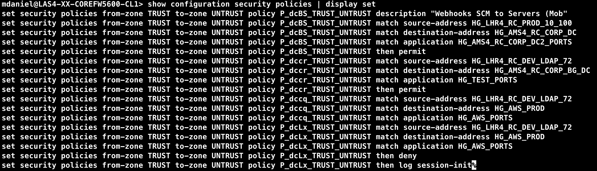
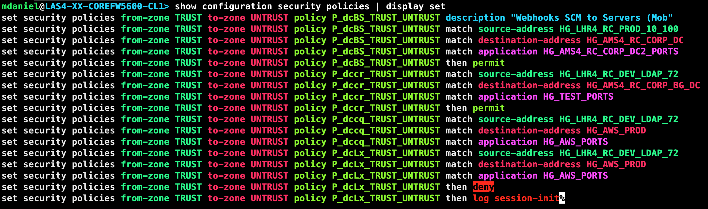
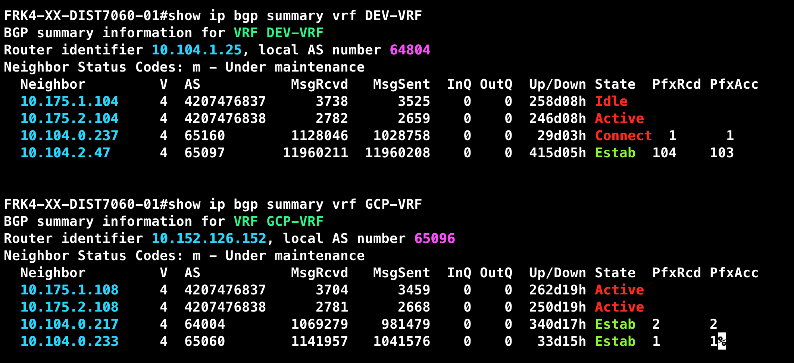
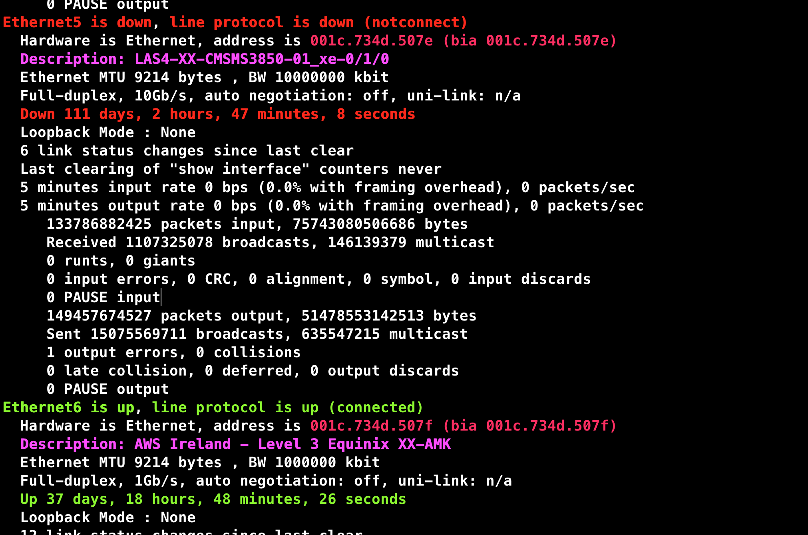
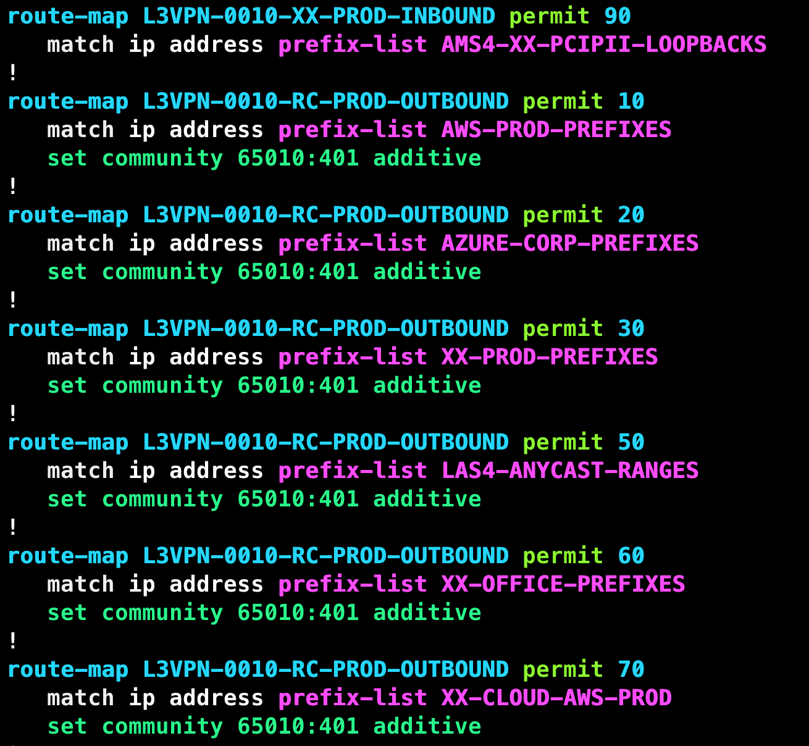
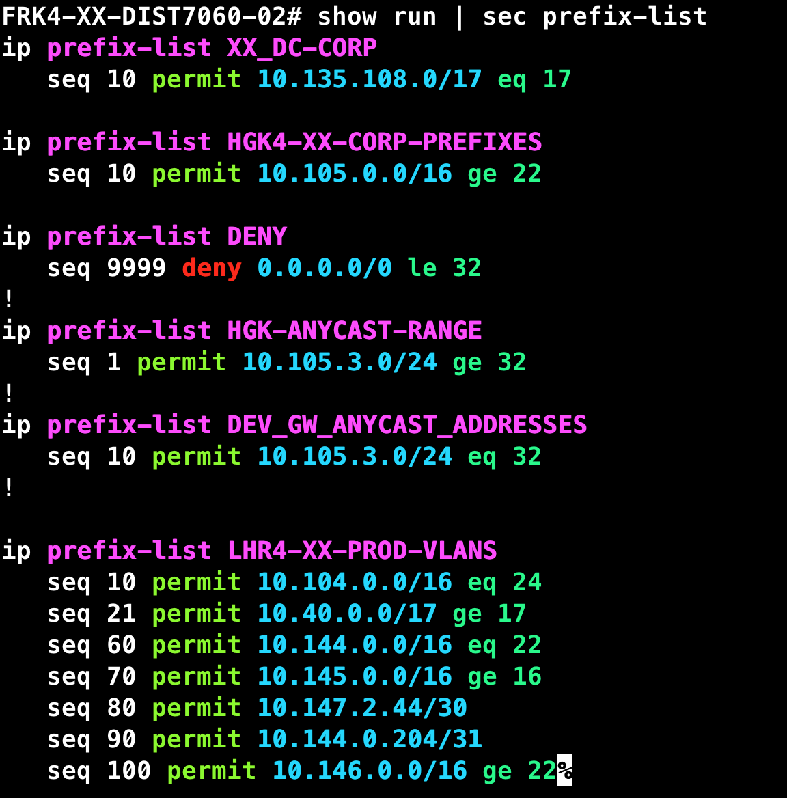

# netcli-highlight

**TLDR:** Add syntax highlighting to your SSH sessions with live network devices (Juniper/Cisco/Arista).

## Table of Contents

- [Overview](#overview)
- [Examples](#examples)
- [Benefits](#benefits)
- [Prerequisites](#prerequisites)
- [Installation](#installation)
- [Usage](#usage)
- [Supported Platforms](#supported-platforms)
- [Limitations](#limitations)
- [Troubleshooting](#troubleshooting)
- [Acknowledgments](#acknowledgments)

## Overview

If you've ever used the CLI on network devices, you've probably struggled to make sense of long configuration outputs. While editors like `vim`, `VSCode`, or `Sublime` provide syntax highlighting, reading config files or command outputs directly on live devices remains challenging.

**Here's a Juniper SRX firewall policy without highlighting:**



This rule contains `source/destination/application/actions` components. Reading one rule is manageable, but parsing through 10+ rules makes it difficult to differentiate each component.

**With syntax highlighting:**



This repo demonstrates how to add real-time syntax highlighting to your SSH sessions with network devices. It's not a comprehensive solution, but a starting point you can customize to your needs.

**Note:** The default color scheme is optimized for dark terminal backgrounds.

## Examples

### Firewall Rules (JunOS)


### BGP Summary (Cisco / Arista)



### Interface Status (Cisco / Arista / JunOS)



### Route Maps (Cisco / Arista)



### Prefix Lists (Cisco / Arista)



## Benefits

- **Faster troubleshooting** - Quickly identify misconfigurations or issues like downed interfaces
- **Customizable colors** - Adapt color schemes to your preference using [HTML color codes](https://htmlcolorcodes.com/)
- **Flexible patterns** - Modify regex patterns to match your specific Network OS (NOS) and version

## Prerequisites

- Python 3.7 or higher
- SSH access to network devices (Juniper/Cisco/Arista)
- A terminal with color support

## Installation

1. Clone this repository:

   ```bash
   git clone git@github.com:danielmacuare/netcli-highlight.git
   cd netcli-highlight/
   ```

2. Install [ChromaTerm](https://github.com/hSaria/ChromaTerm) using one of these methods:

   ```bash
   # Via pip
   pip install chromaterm

   # Via uv (global tool)
   uv tool install chromaterm

   # Via uv (virtual environment)
   uv pip install chromaterm
   ```

3. Copy the configuration file to your home directory:

   ```bash
   cp .chromaterm.yml ~/.chromaterm.yml
   ```

4. Configure your shell to pipe SSH through ChromaTerm:

   **For bash:**

   ```bash
   echo 'ssh() { /usr/bin/ssh "$@" | ct; }' >> ~/.bash_profile
   ```

   **For zsh:**

   ```bash
   echo 'ssh() { /usr/bin/ssh "$@" | ct; }' >> ~/.zshrc
   ```

5. Reload your shell configuration or open a new terminal window.

## Usage

### Testing Locally

Test the highlighting with the provided examples:

```bash
cat tests/arista_pref_list.txt | ct
```

### Using with Live Devices

Connect to your network device via SSH and run any show command:

```bash
ssh user@device
show interfaces
show ip bgp summary
show configuration
```

The output will automatically be highlighted based on the patterns in `~/.chromaterm.yml`.

### Customizing Highlighting

Edit `~/.chromaterm.yml` to:

- Add new regex patterns for your specific commands
- Modify colors (use [HTML color codes](https://htmlcolorcodes.com/))
- Adjust patterns for different NOS versions

Refer to the [ChromaTerm documentation](https://github.com/hSaria/ChromaTerm#highlight-rules) for configuration options.

## Supported Platforms

- **Network OS:** Juniper JunOS, Cisco IOS/IOS-XE/NX-OS, Arista EOS
- **Operating Systems:** Linux, macOS, WSL on Windows
- **Shells:** bash, zsh, and other POSIX-compatible shells

## Limitations

- The included configuration has been tested with a limited set of Juniper, Cisco, and Arista devices
- Different NOS versions may require pattern adjustments in `.chromaterm.yml`
- Some commands or output formats may not be covered by the default patterns
- Highlighting patterns are regex-based and may need tuning for edge cases

## Troubleshooting

**Highlighting not working:**

- Verify ChromaTerm is installed: `ct --version`
- Check that `~/.chromaterm.yml` exists and is readable
- Ensure your shell function is loaded (restart terminal or source your profile)
- Test with local files first: `cat tests/arista_pref_list.txt | ct`

**Colors look wrong:**

- The default config is optimized for dark backgrounds
- Adjust colors in `~/.chromaterm.yml` for your terminal theme
- Verify your terminal supports 256 colors

**SSH function conflicts:**

- If you have existing SSH aliases or functions, they may conflict
- Rename the function or adjust the wrapper accordingly

## Acknowledgments

This project is built on [ChromaTerm](https://github.com/hSaria/ChromaTerm) by [hSaria](https://github.com/hSaria). ChromaTerm is a powerful tool that enables syntax highlighting for interactive applications like SSH. Thank you for creating such a versatile solution!
